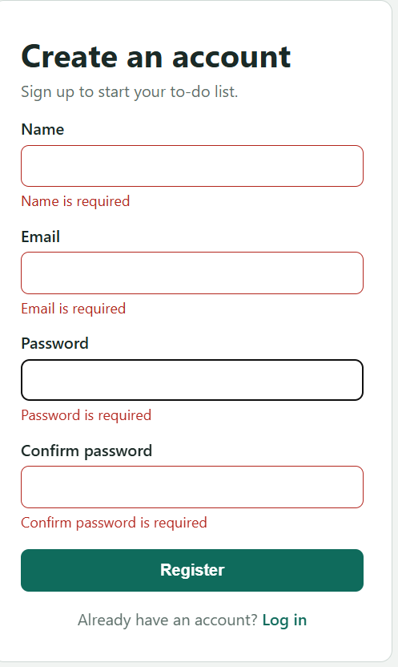
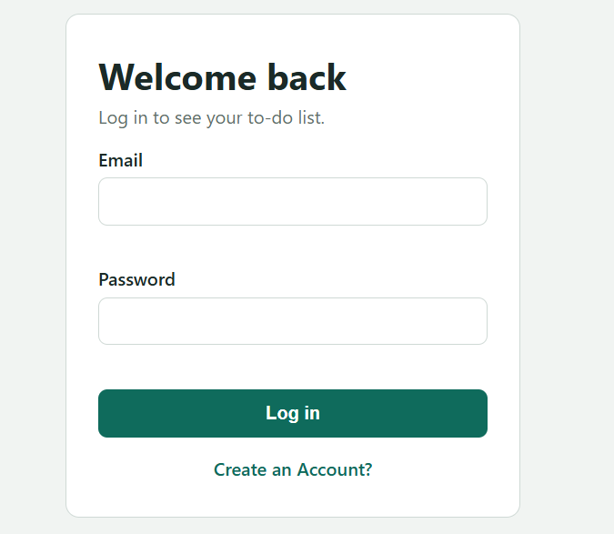
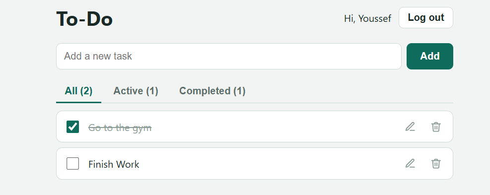
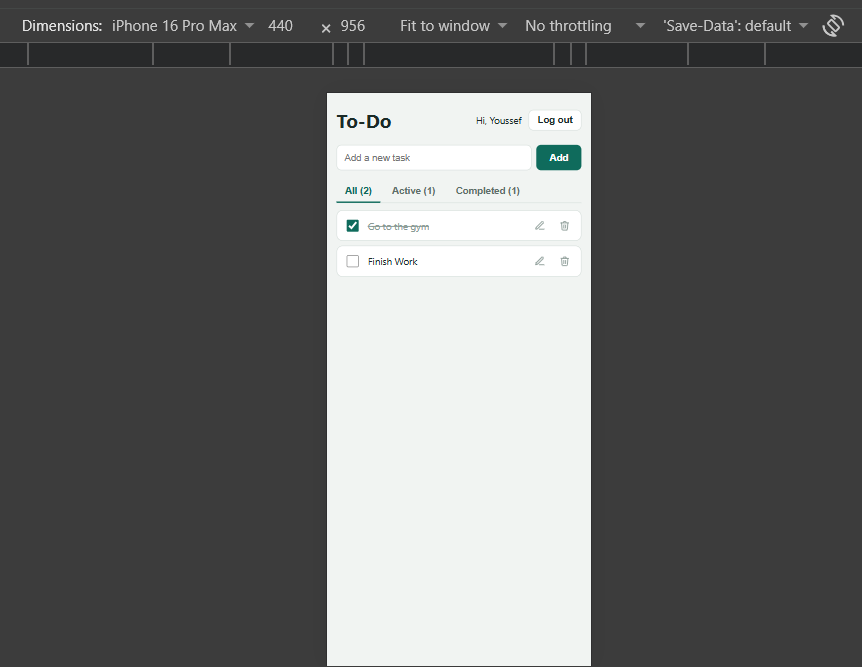

 Lab 2: Login & To-Do Application

A Flask and MySQL web application for user registration, login, and a private to-do list.

1. Team Members

Team Member 1: Youssef Ashraf Attia  2304083 

Team Member 2: Mohamed Abdellatief   2304027 
We worked together on the design, implementation, database integration, testing, and debugging of the application.
## 2. Technologies Used

- Back end: Python, Flask
- Front end: HTML, CSS, JavaScript
- Database: MySQL
- Database connector: PyMySQL
- Password hashing: bcrypt
- Environment configuration: python-dotenv (`.env`)

## 3. Project Structure

```text
project-folder/
├── app.py
├── schema.sql
├── .env.example
├── .gitignore
├── README.md
├── static/
│   ├── css/style.css
│   └── js/
│       ├── login.js
│       ├── register.js
│       └── todos.js
├── templates/
│   ├── login.html
│   ├── register.html
│   └── todos.html
└── screenshots/
    ├── register with errors.png
    ├── login.png
    ├── todo.png
    └── phone sized.png
```

## 4. Setup and Run from a Fresh Machine

### Requirements

Install Python 3, MySQL Server, and Git. During setup, make sure the Python and MySQL commands are available from the terminal.

### Step 1 — Get the project

Clone the GitHub repository, or download and extract its ZIP file. Open a terminal in the project folder.

```bash
git cloneGITHUB_REPOSITORY_URL>
cd <PROJECT_FOLDER>
```

If you downloaded the ZIP, open a terminal inside the extracted project folder instead.

### Step 2 — Create and activate a virtual environment (recommended)

**Windows Command Prompt:**

```bat
py -m venv .venv
.venv\Scripts\activate
```

**Windows PowerShell:**

```powershell
py -m venv .venv
.venv\Scripts\Activate.ps1
```

### Step 3 — Install Python packages

```bash
python -m pip install Flask PyMySQL bcrypt python-dotenv
```

To make future installation easier, save the dependencies in `requirements.txt` with:

```bash
python -m pip freeze > requirements.txt
```

 To install them: `python -m pip install -r requirements.txt`.

### Step 4 — Create the database and tables

1. Start MySQL Server.
2. Open MySQL Workbench or a MySQL terminal using an account allowed to create databases.
3. Run the SQL script at `schema.sql`.

For example, from a terminal where the MySQL client is installed:

```bash
mysql -u root -p < schema.sql
```

The script creates the `registration` database and the `users` and `todos` tables. Make sure `schema.sql` contains only the database/table DDL statements and does not contain personal test data or extra test queries before submitting it. **Warning:** `DROP DATABASE IF EXISTS registration` deletes the existing `registration` database and all its data before recreating it.

### Step 5 — Configure environment variables

Copy `.env.example` to `.env`:

**Windows Command Prompt:**

```bat
copy .env.example .env
```

**PowerShell:**

```powershell
Copy-Item .env.example .env
```

Edit `.env` and enter the credentials for your local MySQL installation. Set a long, random `SECRET_KEY` value. Do not commit or upload `.env`; only commit `.env.example` with placeholder values.

```dotenv
DB_HOST=localhost
DB_USER=root
DB_PASSWORD=your_mysql_password
DB_NAME=registration
SECRET_KEY=replace-with-a-long-random-secret
```

### Step 6 — Start Flask

```bash
python app.py
```

Open the local address shown by Flask, normally:

http://127.0.0.1:5000/

The home route redirects to the login page. Register a new account to begin using the application.

## 5. Features Implemented (Lab Requirements R1–R10)

 — Register: Create an account with name, email, password, and confirmation; duplicate email addresses show `Email Already Exists`. A successful registration logs the user in.
 — Login/Logout: Login checks the email and password hash; invalid credentials show `Invalid email or password`. Logout clears the session.
 — Private list: Users must be logged in to access the to-do list, and each user sees only their own tasks, newest first.
 — Add:Add a task with a title.
 — Edit: Edit a task title.
 — Mark done/undone: Toggle a task's completion status.
 — Delete: Delete a task after confirmation in the interface.
 — Validation: Validate required fields and task-title length in the browser and on the server, with the required error messages. — Security and SQL:** Store bcrypt password hashes rather than plain-text passwords; use parameterized SQL queries; use the logged-in user's ID from the session to scope task changes. — Interface:** Styled responsive interface, visible completion state, validation feedback, and a useful task-list view.

## 6. Screenshots
### Register page with validation errors



### Login page



### To-do list with at least one completed task



### Mobile-sized view



## 7. Answers to the Lab Questions

### (a) Why do UPDATE and DELETE contain `AND user_id = ?`? What changes if it is removed?

The condition checks both the task ID and the ID of the user who is currently logged in. It ensures that a user can update or delete only their own tasks. If the condition is removed, someone could submit another user's task ID and modify or delete that task. The user ID must come from the session, not from a form or request supplied by the browser.

### (b) What happens if a to-do is inserted for a `user_id` that does not exist, and which constraint is that?

MySQL rejects the insert because `todos.user_id` references `users.user_id`, and there is no matching parent user. This is enforced by the **foreign key constraint** (referential integrity).

### (c) Why store a hash and not the password?

A password hash is not the original password and is designed to make recovering it impractical. With bcrypt, the application stores a salted hash and verifies a login attempt by comparing the entered password with the stored hash. If the database is exposed, plain-text passwords would be immediately readable, so they must not be stored.

### (d) `name` is `NOT NULL`: why is a separate check needed for an empty name?

`NOT NULL` prevents SQL `NULL` values, but an empty string (`''`) is still a non-NULL value. The application must validate the input and reject a blank or whitespace-only name before inserting it.

